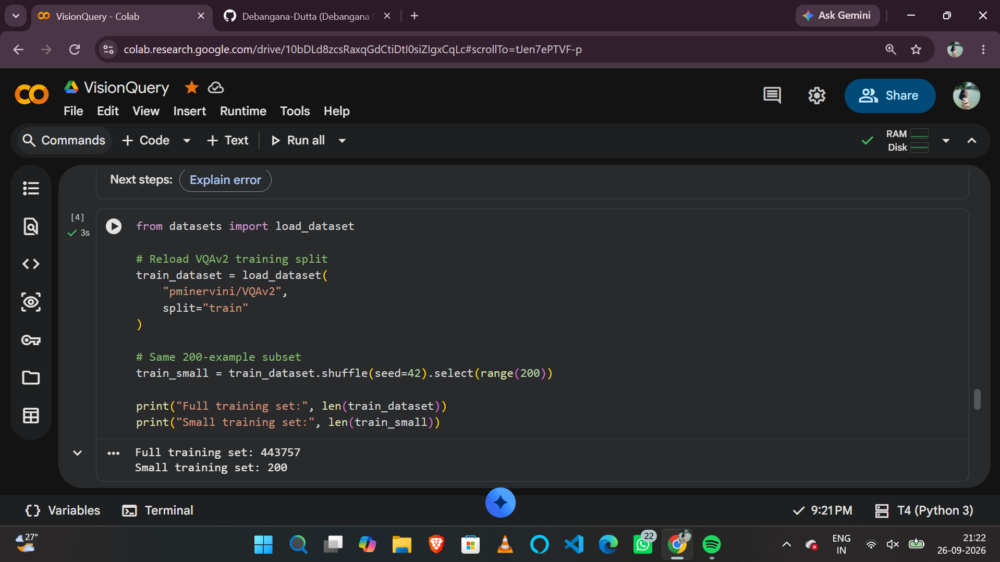
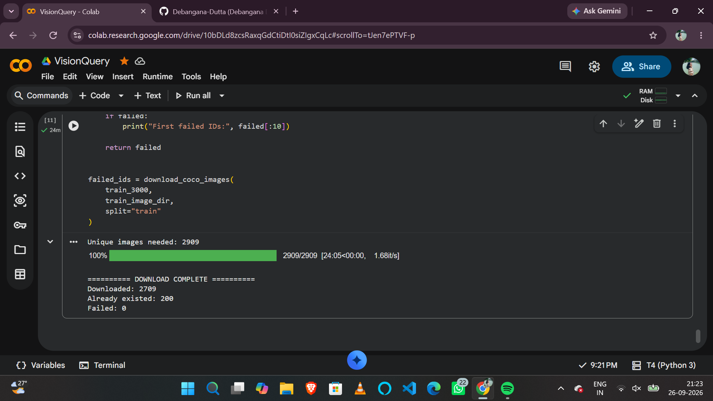
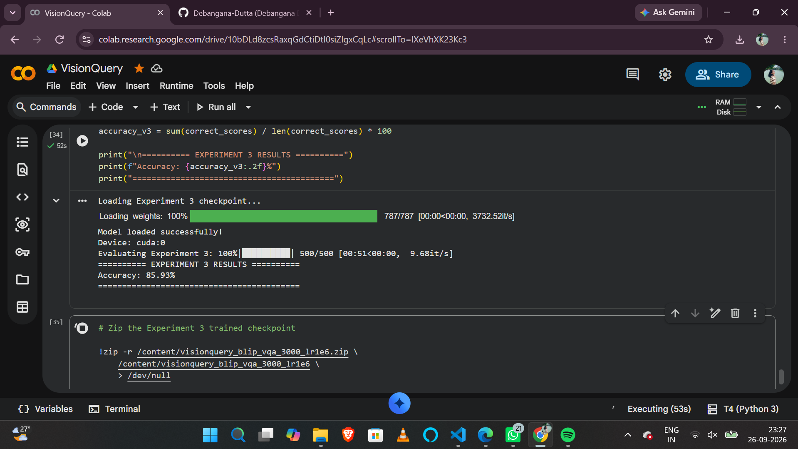
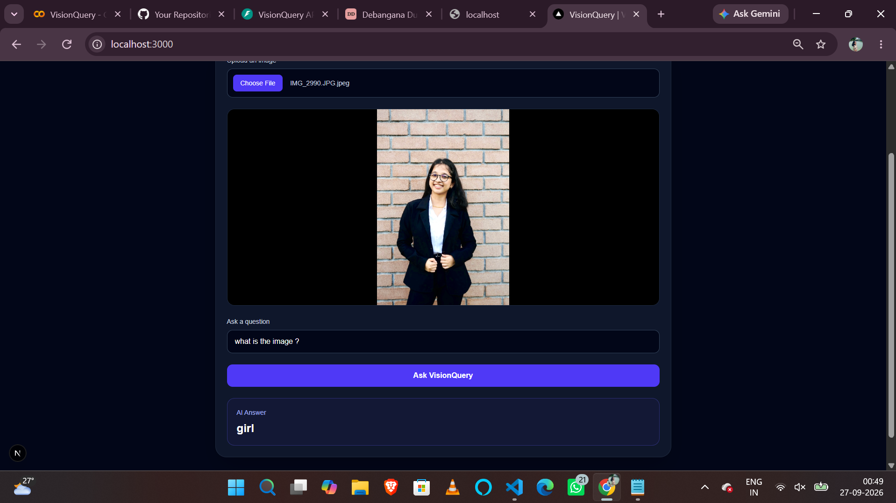
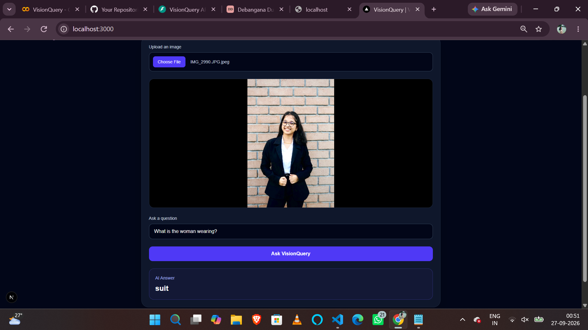

# VisionQuery — Visual Question Answering System

> Ask questions about images and let AI understand both the visual content and the language behind your question.

VisionQuery is an end-to-end **Visual Question Answering (VQA)** system where a pretrained **BLIP vision-language transformer** is further **trained and fine-tuned on 3,000 VQAv2 examples**. The project covers **supervised fine-tuning, learning-rate experimentation, model evaluation, checkpointing, and deployment through a FastAPI backend with a Next.js frontend**.

---

# 🧠 What Problem Does VisionQuery Solve?

Traditional computer vision systems can identify objects, while traditional NLP systems can understand questions and text.

VisionQuery combines both capabilities.

Instead of only asking:

```text
"What objects are present?"
```

VisionQuery allows users to ask questions such as:

```text
"What is the woman wearing?"
"How many people are in the image?"
"What is the image?"
"What color is the car?"
"Where is the person sitting?"
```

The system processes both the **image** and the **natural-language question** and generates an answer based on their combined context.

---

# 🎯 Project Objective

The main objective of VisionQuery is to build a complete and reproducible VQA pipeline covering:

* Pretrained BLIP model initialization
* VQAv2 dataset preparation
* Controlled 3,000-example training subset
* Supervised fine-tuning
* Learning-rate experimentation
* Model evaluation
* Model checkpointing
* Hugging Face model hosting
* FastAPI inference
* Next.js frontend integration
* Reproducible experimentation

---

# 🔬 How VisionQuery Works

```text
                    Input Image
                         |
                         v
              +----------------------+
              |   BLIP Vision        |
              |      Encoder         |
              +----------------------+
                         |
                         v
                 Visual Features
                         |
                         |
User Question ----------+
                         |
                         v
              +----------------------+
              | Cross-Modal Attention|
              +----------------------+
                         |
                         v
              +----------------------+
              | Autoregressive       |
              | Text Decoder         |
              +----------------------+
                         |
                         v
                  Generated Answer
```

The complete workflow includes:

```text
Pretrained BLIP Model
        |
        v
VQAv2 Dataset
        |
        v
3,000 Training Examples
        |
        v
Supervised Fine-Tuning
        |
        v
Learning-Rate Experiments
        |
        v
Evaluation
        |
        v
Model Checkpoint
        |
        v
Hugging Face Hub
        |
        v
FastAPI Backend
        |
        v
Next.js Frontend
        |
        v
User Question + Image
        |
        v
Generated Answer
```

---

# 🤖 Model Architecture

VisionQuery uses:

```text
Salesforce/blip-vqa-base
```

BLIP stands for **Bootstrapping Language-Image Pre-training**.

The model is designed to understand relationships between visual information and natural language.

### Main components

```text
Image
  ↓
Vision Encoder
  ↓
Visual Representation
  ↓
Cross-Modal Attention
  ↓
Question Representation
  ↓
Autoregressive Text Decoder
  ↓
Answer
```

The model combines:

* Vision encoding
* Language understanding
* Cross-modal attention
* Generative answer decoding

---

# 📊 Dataset

VisionQuery uses the **VQAv2 (Visual Question Answering v2)** dataset.

Dataset source:

https://visualqa.org/

For the controlled experiment, **3,000 VQAv2 examples** were selected for supervised fine-tuning, with a fixed **500-question validation subset** used for evaluation.

### Final experiment

| Parameter           | Value     |
| ------------------- | --------- |
| Training examples   | 3,000     |
| Validation examples | 500       |
| Random seed         | 42        |
| GPU                 | NVIDIA T4 |
| Epochs              | 1         |
| Learning rate       | 1e-6      |

The controlled subset makes experimentation faster and allows different configurations to be compared consistently.

### Dataset Preparation

The initial training preparation and controlled subset creation were performed in Google Colab.

<p align="center">
  
</p>

---

# 🧪 Learning-Rate Experiments

Different learning rates were evaluated using the same controlled setup.

| Configuration            | Validation Accuracy |
| ------------------------ | ------------------: |
| Baseline BLIP pretrained |              85.87% |
| Fine-tuning, LR = 2e-5   |              54.87% |
| Fine-tuning, LR = 5e-6   |              79.20% |
| Fine-tuning, LR = 1e-6   |          **85.93%** |

### Observation

The experiments show that the learning rate has a significant effect on fine-tuning behavior.

The `2e-5` configuration resulted in substantially lower validation performance, while the `1e-6` configuration remained close to the pretrained baseline.

The final checkpoint therefore uses:

```text
Learning Rate: 1e-6
Training Examples: 3,000
Validation Examples: 500
Epochs: 1
Seed: 42
```

> **Important evaluation note:** The reported 85.93% result is obtained on the project's fixed 500-question validation subset using a simplified VQAv2-style evaluation procedure. It is **not** an official full VQAv2 benchmark or leaderboard score, and the project does not claim a large benchmark improvement over the pretrained BLIP model.

---

# 🏋️ Training Pipeline

The fine-tuning process follows:

```text
VQAv2
   |
   v
Dataset Filtering
   |
   v
3,000 Training Examples
   |
   v
Image + Question + Answer
   |
   v
BLIP Processor
   |
   v
BLIP-VQA Model
   |
   v
Supervised Fine-Tuning
   |
   v
Validation
   |
   v
Checkpoint
```

Training was performed using:

* PyTorch
* Hugging Face Transformers
* NVIDIA T4 GPU
* VQAv2
* BLIP VQA
* Reproducible random seed

### Training Progress

The training workflow was executed in Google Colab, including the prepared VQAv2 examples used for the fine-tuning experiment.

<p align="center">
  
</p>

---

# 📈 Evaluation Results

The controlled evaluation produced a validation accuracy of **85.93%** for the final `1e-6` learning-rate configuration.

<p align="center">
  
</p>

The result should be interpreted within the project's controlled evaluation setup:

* 500-question validation subset
* Simplified VQAv2-style evaluation
* Fixed random seed of 42
* 3,000-example training subset
* 1 training epoch

This evaluation is intended to compare configurations consistently rather than represent an official full VQAv2 benchmark score.

---

# 💾 Model Checkpoint

The final fine-tuned model checkpoint is approximately **1.45 GB**.

The checkpoint is hosted on Hugging Face rather than being committed directly to GitHub.

### Hugging Face Model

https://huggingface.co/Debangana-Dutta/visionquery-blip-vqa-3000-lr1e6

Model configuration:

```text
Base Model:
Salesforce/blip-vqa-base

Training Examples:
3,000

Validation Examples:
500

Epochs:
1

Learning Rate:
1e-6

Random Seed:
42
```

---

# ⚡ FastAPI Backend

VisionQuery provides a FastAPI backend for model inference.

The primary endpoint is:

```text
POST /predict
```

The backend handles:

```text
Image Upload
     |
     v
Image Validation
     |
     v
Image Decoding
     |
     v
RGB Conversion
     |
     v
BLIP Preprocessing
     |
     v
Model Inference
     |
     v
Answer Decoding
     |
     v
JSON Response
```

### API Response Example

```json
{
  "answer": "suit",
  "question": "What is the woman wearing?",
  "model": "Salesforce/blip-vqa-base",
  "fine_tuned": true,
  "device": "cpu"
}
```

### Available endpoints

```text
GET  /health
POST /predict
```

FastAPI also provides interactive API documentation through:

```text
http://127.0.0.1:8000/docs
```

### Backend Proof of Work

<p align="center">
  
</p>

---

# 🖥️ Next.js Frontend

The frontend provides an interactive interface for VQA inference.

### Main features

* Image upload
* Image preview
* Natural-language question input
* Backend API communication
* Loading state
* Generated answer display
* Error handling
* Responsive interface

### Frontend workflow

```text
User Uploads Image
        |
        v
User Enters Question
        |
        v
Next.js Frontend
        |
        v
FastAPI /predict
        |
        v
BLIP VQA Model
        |
        v
Generated Answer
        |
        v
Answer Displayed
```

### Frontend Proof of Work

<p align="center">
  
</p>

---

# 🧪 Example Predictions

The deployed inference pipeline was tested using multiple natural-language questions against an image.

### Example 1

```text
Question:
What is the image?

Answer:
girl
```

<p align="center">
  
</p>

### Example 2

```text
Question:
What is the woman wearing?

Answer:
suit
```

<p align="center">
  
</p>

### Example 3

```text
Question:
What color is her suit?
```

<p align="center">
  
</p>

These examples demonstrate the system's ability to combine visual information with natural-language questions.

---

# 📁 Project Structure

```text
VisionQuery/
│
├── notebooks/
│   ├── 01_baseline_inference.ipynb
│   ├── 02_dataset_preparation.ipynb
│   ├── 03_finetuning.ipynb
│   └── 04_evaluation.ipynb
│
├── src/
│   ├── dataset.py
│   ├── model.py
│   ├── train.py
│   ├── evaluate.py
│   └── inference.py
│
├── app/
│   ├── app.py
│   └── main.py
│
├── frontend/
│   └── Next.js application
│
├── configs/
│   └── config.yaml
│
├── models/
│   ├── README.md
│   └── visionquery_blip_vqa_3000_lr1e6/
│
├── screenshots/
│   ├── 01_training_subset_200.png
│   ├── 02_training_progress_2709.png
│   ├── 03_evaluation_85_93.png
│   ├── 04_vqa_what_is_the_image.png
│   ├── 05_vqa_woman_wearing.png
│   ├── 06_vqa_suit_color.png
│   └── 06_vqa_frontend.png
│
├── requirements.txt
├── EXPERIMENT_LOG.md
├── LICENSE
└── .gitignore
```

---

# 🚀 Installation

Clone the repository:

```bash
git clone https://github.com/Debangana-Dutta/VisionQuery.git
cd VisionQuery
```

Create a virtual environment:

```bash
python -m venv venv
```

### Windows

```bash
venv\Scripts\activate
```

### Linux/macOS

```bash
source venv/bin/activate
```

Install dependencies:

```bash
pip install -r requirements.txt
```

---

# ▶️ Running the FastAPI Backend

From the project root:

```bash
uvicorn app.main:app --reload
```

The backend will run at:

```text
http://127.0.0.1:8000
```

Open Swagger documentation:

```text
http://127.0.0.1:8000/docs
```

Health endpoint:

```text
http://127.0.0.1:8000/health
```

Prediction endpoint:

```text
POST http://127.0.0.1:8000/predict
```

---

# 🌐 Running the Next.js Frontend

Navigate to the frontend:

```bash
cd frontend
```

Install dependencies:

```bash
npm install
```

Start the development server:

```bash
npm run dev
```

Open:

```text
http://localhost:3000
```

---

# 📱 Streamlit Prototype

The project also includes a Streamlit prototype.

Run:

```bash
streamlit run app/app.py
```

This provides a lightweight interface for testing VQA inference.

---

# 🔁 Reproducibility

Experiments use:

```text
Random Seed = 42
```

The project records:

* Dataset configuration
* Training subset size
* Validation subset size
* Learning rate
* Number of epochs
* Model configuration
* Evaluation results
* Experiment details

This makes the experiments easier to reproduce and compare.

---

# 📈 Evaluation Philosophy

The project focuses on **controlled experimentation rather than claiming benchmark-level improvements**.

The evaluation compares:

```text
Pretrained BLIP
       vs
Fine-Tuned BLIP
       |
       +--> Different Learning Rates
```

This allows the effect of fine-tuning configuration to be observed under the same controlled validation setup.

---

# ⚠️ Limitations

The current implementation has several limitations:

* Training uses a relatively small subset of VQAv2.
* Fine-tuning was limited to one epoch.
* Experiments were performed on a fixed validation subset.
* The reported accuracy is not an official full VQAv2 benchmark score.
* Only a limited learning-rate sweep was performed.
* Generative VQA evaluation can be sensitive to answer normalization.
* CPU inference is slower than GPU inference.
* The current model does not provide calibrated confidence scores.
* The system may struggle with complex reasoning, counting, spatial relationships, or uncommon objects.
* Large model checkpoints are not stored directly in the Git repository.

---

# 🔮 Future Improvements

### Model & Training

* Train on a larger portion of VQAv2.
* Increase the number of training epochs.
* Perform broader hyperparameter sweeps.
* Experiment with learning-rate schedules.
* Explore parameter-efficient fine-tuning such as LoRA/PEFT.
* Compare different BLIP checkpoints.
* Experiment with larger vision-language models.

### Evaluation

* Evaluate on the complete VQAv2 validation set.
* Implement the official VQAv2 evaluation procedure.
* Perform question-category analysis.
* Analyze common failure cases.
* Measure inference latency.
* Add confidence estimation.

### Deployment

* GPU-based inference deployment.
* Model quantization.
* ONNX optimization where appropriate.
* Batch inference support.
* Better API monitoring.
* Experiment tracking and model versioning.

### Frontend

* Improved visual design.
* Answer history.
* Multiple image support.
* Question suggestions.
* Confidence visualization.
* Detailed prediction metadata.
* Better error and loading states.

---

# 🛠️ Tech Stack

### Machine Learning

* Python
* PyTorch
* Hugging Face Transformers
* BLIP
* VQAv2

### Backend

* FastAPI
* Uvicorn
* REST API
* CORS

### Frontend

* Next.js
* React
* TypeScript
* Tailwind CSS

### Development & Deployment

* Google Colab
* NVIDIA T4
* Hugging Face Hub
* Git
* GitHub

---

# 📚 Notebooks

The project is organized into separate notebooks for reproducibility and experimentation.

### 01 — Baseline Inference

Tests the pretrained BLIP model before fine-tuning.

### 02 — Dataset Preparation

Loads VQAv2 and creates the controlled training and validation subsets.

### 03 — Fine-Tuning

Performs supervised fine-tuning with the selected configuration.

### 04 — Evaluation

Evaluates the pretrained and fine-tuned configurations and records the results.

---

# 📝 Experiment Log

Experiment details are maintained in:

```text
EXPERIMENT_LOG.md
```

The log records the configurations and results of the experiments so that different training runs can be compared systematically.

---

# 🔗 Resources

GitHub Repository:

https://github.com/Debangana-Dutta/VisionQuery

Hugging Face Model:

https://huggingface.co/Debangana-Dutta/visionquery-blip-vqa-3000-lr1e6

VQAv2:

https://visualqa.org/

---


# 📜 Credits

### BLIP

The project uses the BLIP vision-language architecture and the pretrained:

```text
Salesforce/blip-vqa-base
```

### VQAv2

The project uses the Visual Question Answering v2 dataset for training and evaluation.

---

# 👩‍💻 Author

**Debangana Dutta**

B.Tech (Hons.) Computer Science & Engineering
XIM University, Bhubaneswar

GitHub:

https://github.com/Debangana-Dutta

---

# ⭐ Project Summary

VisionQuery demonstrates a complete **multimodal AI application pipeline**:

```text
VQAv2 Dataset
      ↓
3,000 Training Examples
      ↓
BLIP Pretrained Model
      ↓
Supervised Fine-Tuning
      ↓
Learning-Rate Experiments
      ↓
Model Evaluation
      ↓
Checkpointing
      ↓
Hugging Face
      ↓
FastAPI Backend
      ↓
Next.js Frontend
      ↓
Interactive Visual Question Answering
```

The project brings together **computer vision, natural language processing, multimodal learning, model fine-tuning, experimentation, evaluation, API development, and frontend engineering** into one end-to-end VQA system.
